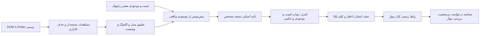

# آماده‌سازی آگهی‌های راینوتک در دیوار

این ابزار مستقل است؛ دیتابیس بات را فقط می‌خواند و هیچ هندلر، منو یا تنظیم بات را تغییر نمی‌دهد. فایل‌های خروجی و صف تأیید در `scratch/divar-campaign` ساخته می‌شوند. بدون کامیت یا پوش.

## اجرا

از ریشه پروژه:

```powershell
python -m divar_campaign.engine
python -m unittest divar_campaign.test_engine -v
```

خروجی‌ها: `report.html` برای بررسی انسانی، `market.csv` و `market.json` برای مدل/قیمت/منبع، `inventory_snapshot.json` و `drafts.json` برای پیش‌نویس‌های موجودی راینوتک، `approval_queue.sqlite3` برای صف پایدار.

## شواهد و محدودیت تحلیل

- ۶۲ کارت یکتا در دو موقعیت فهرست دیوار با مرورگر در ۱۵ اکتبر ۲۰۲۶ مشاهده شد؛ صفحه‌بندی به انتها نرسیده و پوشش کامل بازار ادعا نمی‌شود.
- داده‌های ساختاریافته کارت‌ها از DOM خوانده و در TSV رونویسی شدند؛ عنوان، قیمت تومانی، وضعیت، محل و زمینه نمایش نگهداری شده است. `نامشخص` به معنی فقدان آن فیلد در کارت پیشنهادی است.
- پیشنهادهای اطراف تهران جدا هستند؛ نردبان و پله، زمان انتشار اولیه محسوب نمی‌شوند.
- قیمت، قیمت درخواستی فروشنده است؛ فروش نهایی یا سلامت دستگاه تأیید نشده.
- تنها آگهی Lenovo LOQ 15IRX9 در این نمونه کانفیگ کامل خوانده‌شده دارد. وجود یک مشاهده برای پیشنهاد قیمت بازار کافی نیست.
- آگهی مرجع `ga05juvO` با قیمت ۱۸٫۵ میلیون، ۲۰ عکس و متن چندمدلی، نمونه تبلیغ است. مدل دقیق مشخص نیست و در مقایسه قیمت وارد نمی‌شود. ادعاهای PLAZZA مستقل تأیید نشده‌اند.
- موجودی راینوتک از `rainotek.db` با اتصال `mode=ro` در تراکنش واحد خوانده می‌شود. این یک snapshot محلی است؛ اتصال و تازگی شیت مستقلاً در این ابزار اثبات نشده است. قیمت رقبا جای قیمت فروشگاه نمی‌نشیند.
- عکس‌ها خودکار از رقبا کپی نمی‌شوند؛ عکس عمومی/برندی دیتابیس، عکس واقعی قابل انتشار فرض نمی‌شود. `photos` تا انتخاب عکس واقعی مجاز خالی است.

## معماری هدف و مراحل اجرا



۱. **انجام‌شده:** ذخیره نمونه بازار و جزئیات آگهی مرجع، جداسازی شهرهای اطراف، خواندن موجودی، تولید متن بدون ادعای اضافه، گزارش قابل جست‌وجو، صف محلی تأیید و تست ابطال تأیید.

۲. **مرحله اتصال داده:** تأیید زمان آخرین همگام‌سازی شیت؛ snapshot دارای شناسه نسخه؛ عکس واقعی انتخاب‌شده با شناسه یا checksum؛ تأیید شعبه و محل دقیق؛ خواندن موجودی مجدد هنگام انتشار. اتصال مستقیم به شیت و همگام‌سازی بات در این تغییر دستکاری نشده است.

۳. **تحلیل تخصصی:** گروه‌بندی با مدل دقیق، SKU/CPU کامل، RAM، GPU/VRAM، نوع/حجم ذخیره‌سازی و وضعیت. حداقل سه مشاهده تازه و همسان؛ میانه و بازه مقاوم، حذف داده خراب/تبلیغ چندمدلی و نمایش اندازه نمونه. تا آن زمان پیشنهاد عددی تولید نشود. رقابت‌پذیری، حاشیه سود مصوب فروشگاه و موجودی شعبه با هم سنجیده شوند؛ تغییر قیمت نیازمند تأیید مستقل است.

۴. **تأیید انسانی:** پیش‌نمایش دقیق عنوان، متن، عکس‌ها، قیمت، شعبه، حساب مقصد و هزینه احتمالی. تأیید فقط برای hash همان payload و موجودی، با انقضای ۳۰ دقیقه. تغییر هر جزء، فقدان موجودی یا انقضای تأیید، انتشار را متوقف می‌کند. هسته فعلی از طریق API پایتونی `Queue.approve` تست شده؛ دکمه وب/تلگرامی تأیید هنوز وصل نیست. تأیید واقعی توسط این اجرا ثبت نشده است.

۵. **انتشار واقعی:** اتصال رسمی کنار دیوار پس از دریافت مجوز API و OAuth/کسب‌وکار و بررسی schema دسته‌بندی. رابط فعلی عمداً `publisher_not_configured` می‌دهد و هیچ درخواست انتشار شبکه‌ای ندارد. وضعیت تأیید در این ابزار به معنی تأیید/انتشار دیوار نیست.

۶. **الزامات worker پیش از فعال‌سازی:** claim اتمیک هر job، کلید یکتای product+branch+payload، جلوگیری از تکرار پس از restart، محدودیت تعداد و هزینه مصوب، توقف سراسری، audit log، پاک‌سازی امن خطاها و tokenها. در timeout پس از ارسال، وضعیت `unknown` و استعلام نتیجه؛ ارسال مجدد کور ممنوع. شناسه پذیرش به `submitted` می‌رود؛ `published` فقط با وضعیت رسمی فعال ثبت می‌شود. این worker در نسخه حاضر ساخته نشده است.

## منابع رسمی اتصال

- [جست‌وجوی آگهی‌ها](https://divar-ir.github.io/kenar-docs/openapi-doc/finder-search-post-v-2/)
- [ثبت آگهی و الزام توکن کسب‌وکار/schema](https://divar-ir.github.io/kenar-docs/openapi-doc/post-submit-post-v-2/)
- [OAuth](https://divar-ir.github.io/kenar-docs/oauth/)

نشست تلگرام یا ورود مرورگر دیوار جای مجوز رسمی API نیست. هیچ احراز هویت جدید، خرید، بارگذاری عکس یا انتشار عمومی در این اجرا صورت نگرفته است.
